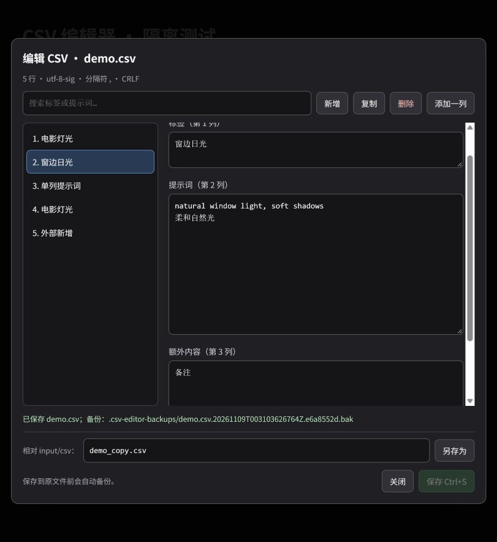

# ComfyUI CSV Prompt Picker

Use multilingual labels and short aliases to select full prompts from CSV files, then edit the mappings directly inside ComfyUI.

**特别感谢 [vslinx](https://github.com/vslinx) 和 [ComfyUI-vslinx-nodes](https://github.com/vslinx/ComfyUI-vslinx-nodes) 在节点开发和实现思路上提供的帮助。** 本项目独立维护，完整致谢见 [ACKNOWLEDGEMENTS.md](ACKNOWLEDGEMENTS.md)。



## 中文

### 多语言标签与简略提示词

把容易理解的中文、英文或其他语言标签放在 CSV 第 1 列，把实际要发送给模型的完整提示词放在第 2 列。

这样可以用简短、熟悉的名称选择较长提示词，也可以用中文标签管理英文提示词，或为同一段提示词配置不同语言的标签。内容由你在 CSV 中预先定义，适合管理常用风格、光照、镜头等预设。

本仓库提供节点代码、说明和人工编写的通用示例。个人提示词库由使用者在本地管理。

### 功能

- 从 `input/csv` 及子目录选择 CSV，支持单选、多选、随机选择和提示词拼接。
- 支持单列 CSV，或“显示标签 + 提示词”的两列 CSV。
- 节点文件名右侧的 **✎** 和文件选择列表中的 **✎ 编辑** 可打开编辑器。
- 搜索、新增、复制、删除条目；编辑长提示词、换行、引号及额外列。
- 保存 / **Ctrl+S**、另存为、未保存修改提示。
- 改写原文件前自动备份；检测外部修改，避免覆盖其他编辑器的更改。
- 保存后刷新当前页面引用同一 CSV 的节点，下次执行检测文件内容变化。

### 安装

在 ComfyUI 的 `custom_nodes` 目录中运行：

```bash
git clone https://github.com/Iyanzl/ComfyUI-CSV-prompt-picker.git
```

然后重启 **ComfyUI 后端**，并刷新浏览器页面；如果看不到编辑按钮，请尝试 **Ctrl+F5**。

运行依赖只有 ComfyUI 已提供的 `aiohttp` 和 Python 标准库，不需要安装额外的模型或 GPU 库。

在节点菜单的 **CSV → utility** 中添加 **CSV Prompt Picker**。已有工作流中的节点类型 `CSV_MultiLangPromptPicker` 和保存字段保持兼容。

### CSV 格式与使用

1. 将 CSV 放入 `ComfyUI/input/csv/`。也可以将 [examples](examples) 中的示例复制到这里。
2. 在节点中点击 **Select CSV File**，选择文件，再选择所需条目。
3. 点击文件名旁 **✎** 编辑，完成后点击 **保存** 或按 **Ctrl+S**。
4. **另存为** 的路径相对于 `input/csv`，可以使用已有子目录；副本需要在节点中重新选择。

两列示例（**不需要表头**，表头会被当作普通条目）：

```csv
电影灯光,"soft cinematic light, warm tones"
窗边日光,"natural window light, soft shadows"
```

单列示例：

```csv
soft cinematic light
natural window light
```

编辑器保留原有编码、分隔符、完整行序、重复标签、空行和额外列。运行时沿用原有选词规则：只使用前两列；单列时标签也是输出；同名标签以最后一行的值为准。修改内容后，CSV 的引号形式可能被标准化；未修改直接保存会保留原始字节。

标签改名或删除后，节点中已失效的选择会清除并提示，其他有效选择保留。外部编辑器造成保存冲突时，可以另存为新文件保留草稿。

### 自动备份与恢复

修改原 CSV 时，原始文件会备份到：

```text
ComfyUI/input/csv/.csv-editor-backups/<原有子目录>/<文件名>.<时间戳>.<标识>.bak
```

恢复时，关闭编辑窗口，将所需 `.bak` 文件复制回原 CSV 路径，再重新打开。备份不自动清理，长期使用时可以自行归档。另存为创建新文件，不覆盖现有文件。

### 测试范围

测试覆盖编码、分隔符、引号、多行内容、单列、重复标签、额外列、空行、备份、版本冲突、另存为、HTTP 接口和执行缓存。界面已用真实节点脚本与路由进行隔离测试；完整 ComfyUI 和不同前端版本的兼容性仍欢迎反馈。

## English

### Features

Map readable labels in any language, or short aliases, to full prompts defined in your CSV. This lets you organize English prompts using Chinese labels, expand short preset names into longer text, or define several language-specific labels for a shared prompt. Keep your personal prompt collection locally; this repository contains code and hand-written generic examples.

Load and combine presets with single/multiple selections, random picks, draggable rows and extra prompts. Open the built-in editor with **✎** beside a filename or **✎ 编辑** in the file picker.

The editor supports search, add/duplicate/delete, extra columns, multiline prompts, save, **Ctrl+S**, and save as. It preserves duplicate rows and existing encodings/delimiters, creates backups before replacing originals, detects external edits, and refreshes nodes referencing the saved CSV in the current page. Runtime execution also detects CSV content changes.

### Install and use

Clone this repository into `ComfyUI/custom_nodes`, restart the backend, and reload the frontend. Add the node under **CSV / utility**, copy CSV files into `ComfyUI/input/csv`, and click **Select CSV File**.

CSV files have no special header: column 1 is the display label, column 2 is the output prompt. With only one column, the label is also the output. Extra columns remain editable and are preserved, but are not used for prompt generation. Duplicate labels retain the original last-value-wins behavior.

Before replacing an original CSV, the editor saves its previous bytes under `input/csv/.csv-editor-backups`. Restore a backup by copying it over the original CSV with the editor closed. If another editor changes the file, saving the original is rejected; **save as** can preserve your draft in a new file.

### Development tests

From this repository, using a Python environment with `aiohttp`:

```bash
python -m unittest discover -s tests -v
```

For a clean development environment:

```bash
python -m pip install -r requirements-dev.txt
```

Tests use synthetic examples by default. Set `CSV_PICKER_CORPUS_DIR` to test your own CSV collection on temporary copies. `CSV_PICKER_TEST_TMP` can override the temporary test directory. No ComfyUI installation or GPU is required for these tests.

To run the disposable UI harness:

```bash
python tests/ui_server.py --port 8199
```

Open `http://127.0.0.1:8199` locally. It uses the real JavaScript modules and HTTP routes with a lightweight canvas host; it does not replace validation inside a full ComfyUI installation.

### Acknowledgements and license

Special thanks to **[vslinx](https://github.com/vslinx)** and **[ComfyUI-vslinx-nodes](https://github.com/vslinx/ComfyUI-vslinx-nodes)** for help and implementation ideas, including UI and widget persistence patterns. Existing `vslinx_*` workflow property names are retained for compatibility. This is an independently maintained project, not an official upstream release or endorsement.

Released under **GNU GPL v3**. See [LICENSE](LICENSE) and [ACKNOWLEDGEMENTS.md](ACKNOWLEDGEMENTS.md). Modifications in this standalone editor version are dated **2026-11-09**.
